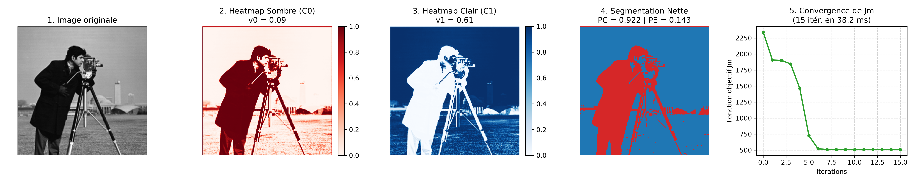
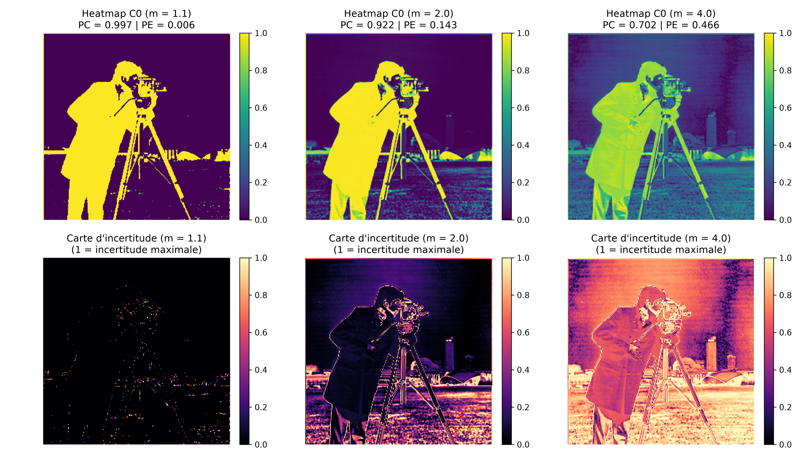
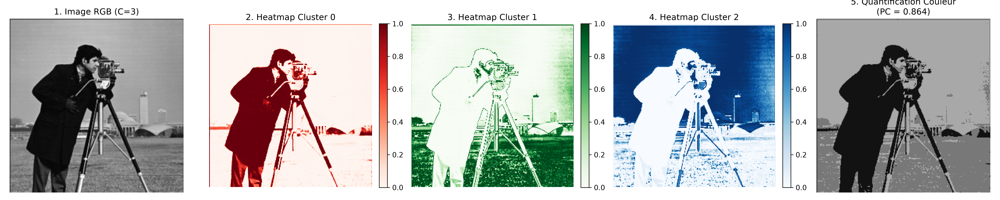
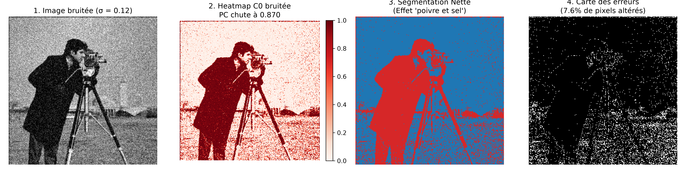

# Segmentation d'Images par l'Algorithme Fuzzy C-Means (FCM)

  
  
  
  

Implémentation *from scratch* et intégralement vectorisée de l'algorithme de classification floue **Fuzzy C-Means (FCM)** appliquée à la segmentation d'images, accompagnée d'une étude expérimentale complète (convergence, sensibilité paramétrique, extension multi-clusters et robustesse au bruit spatial).

---

## 1. Cadre Mathématique

Contrairement au clustering strict (*Hard Clustering*, ex. $K$-Means) qui impose une appartenance binaire $\{0, 1\}$, l'algorithme **FCM** modélise l'incertitude aux frontières des régions en attribuant à chaque pixel $x_i \in \mathbb{R}^d$ un degré d'appartenance continu $u_{ij} \in [0, 1]$ au cluster $j$.

L'optimisation repose sur la minimisation alternée de la fonction d'énergie pondérée $J_m$ :

$$J_m(U, V) = \sum_{i=1}^{N} \sum_{j=1}^{C} u_{ij}^m \|x_i - v_j\|_2^2 \qquad \text{sous contrainte} \quad \sum_{j=1}^{C} u_{ij} = 1, \quad \forall i \in \{1, \dots, N\}$$

* **$N$** : nombre total de pixels ($256 \times 256 = 65\,536$).
* **$C$** : nombre de clusters (régions).
* **$m > 1$** : exposant de flou (*fuzzifier*) contrôlant le degré de chevauchement entre classes.
* **$v_j$** : centroïde du cluster $j$.

### Critères quantitatifs d'évaluation
La qualité des partitions floues est évaluée sans vérité terrain à l'aide de deux métriques normalisées :
* **Partition Coefficient ($V_{PC}$)** : $V_{PC} = \frac{1}{N} \sum_{i=1}^{N} \sum_{j=1}^{C} u_{ij}^2 \in \left[\frac{1}{C}, 1\right]$ *(plus il est proche de 1, plus la partition est nette)*.
* **Partition Entropy ($V_{PE}$)** : $V_{PE} = -\frac{1}{N} \sum_{i=1}^{N} \sum_{j=1}^{C} u_{ij} \ln(u_{ij}) \in [0, \ln(C)]$ *(plus il est proche de 0, moins l'ambiguïté globale est élevée)*.

---

## 2. Architecture du Dépôt

    .
    ├── fuzzy_c_means.py                  # Implémentation vectorisée FCM & générateur d'expériences
    ├── image.png                         # Image de référence (Cameraman 256x256)
    ├── figures/                          # Planches de résultats haute résolution (300 DPI)
    │   ├── fig1_base_convergence.png     # Segmentation binaire (C=2, m=2) & décroissance de Jm
    │   ├── fig2_parametre_m.png          # Étude de sensibilité à m et cartes d'entropie locale
    │   ├── fig3_multicluster_rgb.png     # Extension multi-régions (C=3) & quantification
    │   └── fig4_robustesse_bruit.png     # Test de limite sous bruit gaussien (sigma=0.12)
    ├── rapport/
    │   └── main.tex                      # Code source LaTeX du rapport scientifique
    └── README.md                         # Documentation du projet

### Points clés d'ingénierie numérique
* **Vectorisation intégrale :** Aucune boucle Python sur les pixels ; calculs exécutés par produits matriciels (`@`) et *broadcasting* `NumPy` ($< 40\text{ ms}$ par segmentation)[cite: 1].
* **Stabilité numérique :** Interception des singularités ($d_{ij} = 0$) via un masque booléen (`zero_mask`) prévenant toute division par zéro.
* **Reproductibilité :** Initialisation contrôlée (`seed=42`) et tri automatique des clusters par luminance croissante ($v_0 < v_1 < \dots < v_{C-1}$).

---

## 3. Installation et Exécution

**Prérequis :**

    pip install -r requirements.txt

**Lancement des expériences :**
Exécutez le script principal pour calculer les métriques quantitatives dans le terminal et régénérer automatiquement l'ensemble des figures dans `figures/` :

    python fuzzy_c_means.py

---

## 4. Résultats Expérimentaux & Analyse

### Synthèse quantitative (Image *Cameraman*, $256 \times 256$)

| Configuration expérimentale | Itérations | Temps (ms) | $V_{PC} \uparrow$ | $V_{PE} \downarrow$ | Interprétation physique |
| :--- | :---: | :---: | :---: | :---: | :--- |
| **Base ($C=2, m=2.0$)** | 15 | 38,23 | **0,9217** | **0,1426** | Séparation nette silhouette ($v_0=0,095$) / ciel ($v_1=0,606$)[cite: 1] |
| **Quasi-dur ($C=2, m=1.1$)** | 12 | 31,40 | 0,9967 | 0,0056 | Comportement asymptotique identique au $K$-Means[cite: 2] |
| **Très flou ($C=2, m=4.0$)** | 23 | 58,12 | 0,7016 | 0,4657 | Dilution des appartenances vers $1/C = 0,5$[cite: 2] |
| **Multi-clusters ($C=3, m=2.0$)** | 21 | 99,91 | 0,8644 | 0,2518 | Décomposition en 3 régions (manteau, pelouse, ciel)[cite: 3] |
| **Bruit gaussien ($\sigma=0.12$)** | 16 | 40,15 | 0,8696 | 0,2284 | Artefact « poivre et sel » (**7,57 %** de pixels altérés)[cite: 4] |

### Visualisation des campagnes de test

#### A. Segmentation de référence ($C=2, m=2$) & Convergence de $J_m$
[cite: 1]

#### B. Sensibilité à l'exposant de flou $m \in \{1.1, 2.0, 4.0\}$ et Entropie locale $H(x_i)$
[cite: 2]

#### C. Extension multi-clusters ($C=3$) et quantification
[cite: 3]

#### D. Analyse critique : Sensibilité au bruit spatial ($\sigma = 0.12$)
[cite: 4]

---
